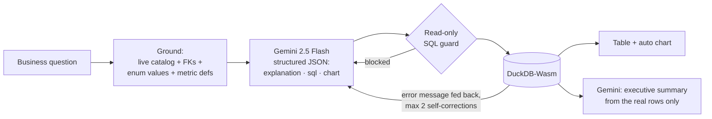
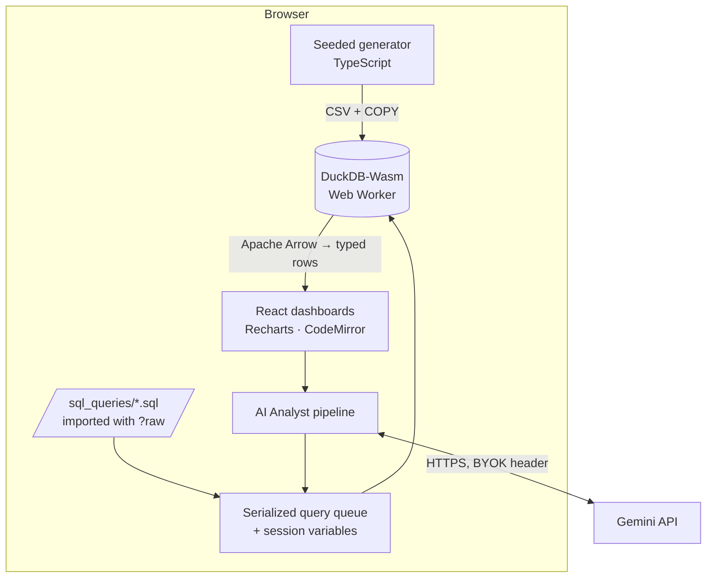
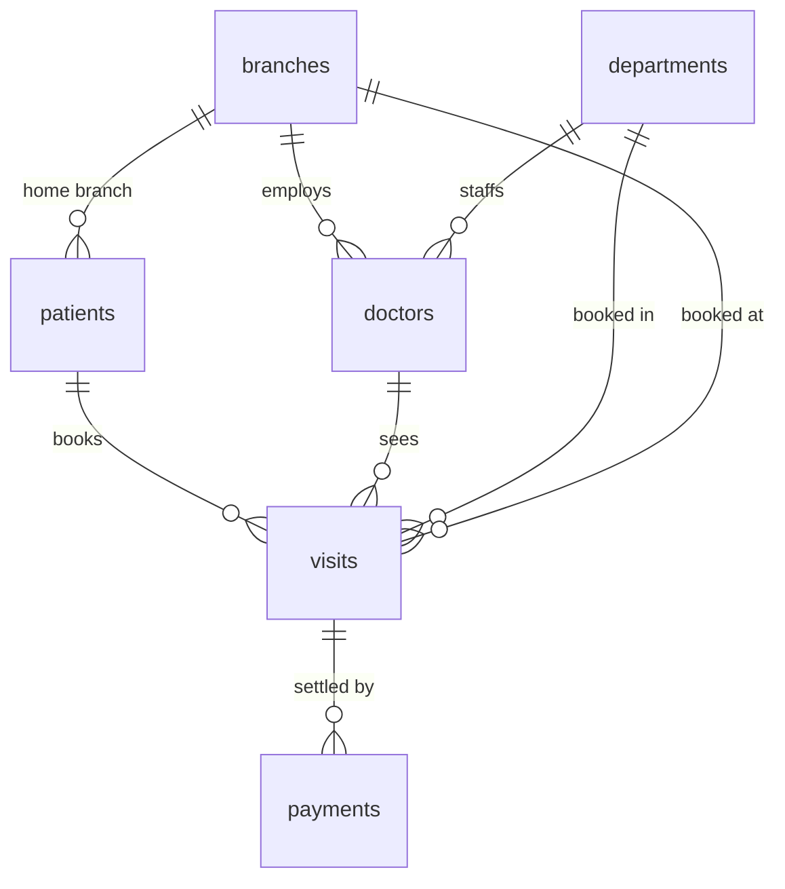

# ClinicPulse — Self-Service BI & AI Analyst for a Clinic Network


A product-analytics case study of a fictional **3-branch, 8-department clinic network**: 12 months of operations, 70,249 rows across 6 normalized tables. It is analyzed with **real SQL running inside the browser** (DuckDB-Wasm, no backend) and an **AI analyst** that turns business questions into SQL, runs it, and writes up the result.

- **4 dashboards**: Executive KPIs & unit economics, Cohort Retention, Conversion Funnel, and a SQL Workspace with a live ER diagram.
- **15 commented SQL files** in [`/sql_queries`](sql_queries). The app imports these exact files, so every chart's **`SQL`** button opens the query behind it.
- **AI Data Analyst Copilot** (Gemini Text-to-SQL), with a no-key **Demo mode** for reviewers.

> **Live demo:** this repo deploys itself to GitHub Pages ([workflow](.github/workflows/deploy.yml)). Enable *Settings → Pages → Source: GitHub Actions* after pushing, and the app is served at `https://<user>.github.io/<repo>/`. To run it locally, see [Run it](#8-run-it).

---

## 1. Business problem

ClinicPulse runs a flagship (**Central Campus**) and two newer branches (**Northside**, **Riverside**). Leadership's questions are the usual ones for a care network:

1. Is revenue growth healthy, or is it hiding operational leaks?
2. Where do patients drop out between **booking → confirmation → visit → coming back**?
3. Which acquisition channels bring patients who **stay**, and not just patients who show up once?
4. What does a missed appointment actually **cost**, and where?

The data is **synthetic but not random**. [`src/data/generator.ts`](src/data/generator.ts) simulates every patient journey with seasonality, weekday capacity, price indexation, doctor seniority, insurance settlement lags, and a 15-month burn-in, so the window opens on a mature patient base. It also plants **three operational incidents as ground truth**. The dashboards and the anomaly detector find them from the data alone; nothing is hard-coded. That makes this a test of whether the methods actually work.

## 2. Key findings

Network baseline over Nov 2025 – Oct 2026: **$2.19M** net revenue, **21,594** attended visits, **32.2%** net (contribution) margin, **12.2%** no-show rate.

| # | Finding | Evidence | Estimated impact |
|---|---|---|---|
| 1 | **Riverside confirmations collapsed in Sep 2026** | Confirmation rate **91.7% → 65.1%** (Jun–Aug vs Sep–Oct). Booking-to-attendance **81.4% → 71.1%**, while other branches held at ~81%. Flagged automatically: z = 15.6. | ≈ **123 lost visits ≈ $13.7K** net revenue in 2 months, still unresolved |
| 2 | **Dermatology no-shows tripled from Aug 2026** | No-show rate **11.6% → 34.4%** (Nov–Jul vs Aug–Oct). Confirmations fell 92% → 74% at the same time, pointing to a broken reminder/confirmation step. z = 8.2. | ≈ **172 excess no-shows ≈ $21K** (≈ $7K/month) |
| 3 | **Summer Instagram campaign bought low-quality cohorts** | Jun–Jul 2026 cohorts were **31.5% Instagram** (vs 15.6% normally) and retained **17.7%** in Month +1, vs **24.3%** for other cohorts. Instagram's 90-day LTV is **$134.62** (30.0% repeat), vs **$175.14** (48.5%) for Referral. | Lower lifetime value per acquired patient; channel ROI needs CAC data |
| 4 | **The biggest funnel leak is after the first visit** | Of 11,296 new patients, 89.1% confirm, 86.7% of those attend, but only **30.5% return within 60 days**. **Ophthalmology** repeat rate is **21.2% (−9.3 pp)** vs the network. | The largest pool of recoverable revenue |
| 5 | **Dentistry has the costliest chronic no-shows** | Highest revenue share (**18.9%**) and a structural **13.9%** no-show rate. Missed appointments were quoted at **$66.5K**, the most of any department. | Recurring, not an incident: a deposit/reminder policy candidate |
| 6 | **Growth is real but uneven** | Monthly revenue **$152.4K → $206.0K** (+35%, compound **2.8%/month**). **August fell 15.6% MoM** (summer demand plus the Dermatology incident), and September rebounded 15.7%. | Plan capacity and recall campaigns before August |
| 7 | **Insurance is the slow, leaky cash channel** | Overall collection rate is **94.7%**, but insurance is **86.1%** with a **3.8%** denial rate. **$61.2K** in claims is still open, all under 60 days old. | Working-capital lag, plus denials to appeal |

### Recommendations

1. **Riverside, now:** restore call-center confirmation capacity and add a daily "tomorrow's unconfirmed bookings" call list. Success metric: confirmation rate back above 88% within 4 weeks ([`11_funnel_trend.sql`](sql_queries/11_funnel_trend.sql)).
2. **Dermatology:** audit the SMS/reminder integration changed around 1 Aug and reinstate 24-hour reminders. Until no-shows are back near 12%, overbook high-risk slots modestly.
3. **Marketing:** re-evaluate Instagram spend on **LTV:CAC**, not acquisition volume. Before scaling, test a first-visit follow-up offer to lift its 30% repeat rate.
4. **Retention program:** book the follow-up at checkout, starting with Ophthalmology. Each +1 pp of 60-day repeat rate among the 8,729 first-time attendees is ≈ 87 extra return visits.
5. **Dentistry:** A/B-test a booking deposit plus a 48-hour reminder, and measure the no-show change against the 13.9% baseline.

## 3. Methodology (what makes the numbers trustworthy)

- **Semantic layer.** The `fct_visits` view ([`00_schema.sql`](sql_queries/00_schema.sql)) defines revenue, cost, commission and funnel flags once, so the dashboards, the SQL library and the AI all use the same definitions.
- **Left-censoring.** Patients registered before the window have unobserved first visits. Cohort, funnel and LTV queries include only `is_new_patient`. Without this guard, the whole legacy base lands in the first cohort.
- **Right-censoring.** Cells that can't be observed yet are removed from the cohort matrix rather than shown as 0%. 60-day retention and 90-day LTV only score patients with a full follow-up window.
- **Anomaly detection without false alarms.** [`05_anomaly_detection.sql`](sql_queries/05_anomaly_detection.sql) compares each segment-month with a **volume-weighted trailing 3-month baseline** using a **two-proportion z-test**. About 200 segment-months are tested at once, so only moves that are **z ≥ 4 and ≥ 4 pp** are surfaced. A first version used the stddev of 3 points and flagged noise (Pediatrics, Dentistry); the current version separates the two real incidents (z = 15.6, 8.2) from the best noise candidate (z = 3.2).
- **Data-quality gates.** [`14_data_quality_checks.sql`](sql_queries/14_data_quality_checks.sql) runs 12 assertions (referential integrity, temporal logic, payment reconciliation), and all 12 pass. The data model enforces PKs, FKs and `CHECK` constraints, and stores money as `DECIMAL(10,2)`.

## 4. AI Data Analyst Copilot

The **AI Analyst** tab answers free-form questions end to end:



- **Strict schema grounding** ([`src/ai/schemaContext.ts`](src/ai/schemaContext.ts)). The prompt is built at runtime from `information_schema` and `duckdb_constraints()`, so it can't drift from the database. It covers tables, columns, types, PK/FK, the `fct_visits` semantic view, exact categorical values, business metric definitions (ARPU, no-show rate, cohort retention, LTV), how relative dates resolve ("last quarter" = Q3 2026), and DuckDB dialect rules.
- **Two-stage prompting** ([`src/ai/prompts.ts`](src/ai/prompts.ts)). Stage 1 generates the SQL plus a chart hint using `responseSchema`. Stage 2 writes the headline, summary, recommendation and caveat, and may only cite numbers present in the result table.
- **Guardrails** ([`src/ai/sqlGuard.ts`](src/ai/sqlGuard.ts)). Only a single `SELECT`/`WITH` statement runs. DDL/DML, `SET`, `PRAGMA`, `ATTACH`, file readers and multi-statement payloads are blocked, including a `DELETE` hidden inside a CTE.
- **Self-correction.** If DuckDB rejects the query, its error message goes back to Gemini, which gets up to 2 repair attempts. Each repair is shown in the UI.
- **Safe charts** ([`src/ai/chart.ts`](src/ai/chart.ts)). Chart hints are validated against the actual result columns. Only series that share a unit are plotted together (never a dual axis).
- **BYOK.** The Gemini key is entered in the UI, stored only in the browser's `localStorage`, and sent only to Google's API in the `x-goog-api-key` header (never in a URL). Nothing is hard-coded.
- **Demo mode (no key).** The five suggested questions run curated SQL **live on DuckDB**, and their narratives are computed from the live result rows ([`src/ai/demo.ts`](src/ai/demo.ts)). Every number a reviewer sees is real.

> Limits: an LLM can still write SQL that runs but answers a subtly different question. The UI always shows the generated SQL, its explanation and an "Open in SQL Workspace" button so the answer can be audited.

## 5. SQL showcase

| File | Question it answers | Techniques |
|---|---|---|
| [`00_schema.sql`](sql_queries/00_schema.sql) | Data model + semantic layer | DDL, PK/FK/`CHECK`, view with business logic |
| [`01_kpi_monthly.sql`](sql_queries/01_kpi_monthly.sql) | KPIs with MoM deltas | `FILTER` aggregates, named `WINDOW`, `LAG`, % vs pp deltas, running total |
| [`02_daily_volume.sql`](sql_queries/02_daily_volume.sql) | Daily volume and weekly pattern | `generate_series` date spine, gap-filling, 7-day moving average |
| [`03_department_unit_economics.sql`](sql_queries/03_department_unit_economics.sql) | Per-visit P&L by department | share of total `SUM() OVER ()`, `RANK`, cost of no-shows |
| [`04_noshow_by_department.sql`](sql_queries/04_noshow_by_department.sql) | No-show trend vs own baseline | frame `3 PRECEDING AND 1 PRECEDING` |
| [`05_anomaly_detection.sql`](sql_queries/05_anomaly_detection.sql) | What broke, where, when? | long-format `UNION ALL`, sliding `SUM() OVER`, two-proportion z-test, `QUALIFY` |
| [`06_cohort_retention.sql`](sql_queries/06_cohort_retention.sql) | Month 0…+6 retention matrix | `ARG_MIN` first touch, `DATEDIFF`, observable-cell grid, `GROUPING SETS` weighted total |
| [`07_cohort_ltv.sql`](sql_queries/07_cohort_ltv.sql) | Cumulative LTV per cohort | partitioned running totals, grid densification |
| [`08_time_to_return.sql`](sql_queries/08_time_to_return.sql) | When do patients come back? | `LEAD`, bucketing, CDF, `QUANTILE_CONT` |
| [`09_funnel_overall.sql`](sql_queries/09_funnel_overall.sql) | New-patient journey funnel | `ROW_NUMBER` first event, correlated `EXISTS`, `FIRST_VALUE`/`LAG` |
| [`10_funnel_breakdown.sql`](sql_queries/10_funnel_breakdown.sql) | Bottleneck by department and branch | `GROUPING SETS` + `GROUPING()`, benchmark gaps, classification |
| [`11_funnel_trend.sql`](sql_queries/11_funnel_trend.sql) | When did conversion change? | multi-dimension monthly rates, pp change |
| [`12_doctor_performance.sql`](sql_queries/12_doctor_performance.sql) | Doctor leaderboard within department | `DENSE_RANK`, `NTILE`, `PERCENT_RANK`, NULL-safe `LEAD` retention |
| [`13_collections_ar_aging.sql`](sql_queries/13_collections_ar_aging.sql) | Accrual vs cash, AR aging | pre-aggregation to avoid fan-out, `ROLLUP` |
| [`14_data_quality_checks.sql`](sql_queries/14_data_quality_checks.sql) | Can we trust the data? | anti-joins, temporal assertions, reconciliation tests |

Filters reach SQL as **DuckDB session variables** (`SET VARIABLE start_date = …` → `getvariable('start_date')`), so every file runs unchanged in the app, the SQL Workspace, or the DuckDB CLI.

## 6. Architecture



| Layer | Choice | Why |
|---|---|---|
| Engine | **DuckDB-Wasm 1.32 (DuckDB 1.4)** | Columnar OLAP in the browser: every metric is real SQL, aggregating ~26K bookings in tens of ms |
| UI | **React 18 + TypeScript + Vite 5 + Tailwind** | Typed end to end; light and dark themes |
| Charts | **Recharts 3** | CVD-validated categorical palette tied to entity ids (a department keeps its color under any filter); one unit per axis |
| Editor | **CodeMirror 6** | SQL highlighting with schema-aware autocomplete |
| AI | **Gemini 2.5 Flash** via REST | Structured JSON output; model is configurable in the UI |
| Deploy | **GitHub Pages** via Actions | Fully static `dist/`; the ~34 MB Wasm binaries ship as hashed assets |

## 7. Data model



| Table | Grain | Rows |
|---|---|---|
| `branches` | branch | 3 |
| `departments` | department (list price, specialty group) | 8 |
| `doctors` | doctor (seniority, hire date, commission rate) | 54 |
| `patients` | patient (channel, insurance, home branch) | 22,262 |
| `visits` | **booking** of any outcome: created → confirmed → completed / no-show / cancelled | 26,194 |
| `payments` | settlement per completed visit, plus refund rows; claims can be pending or denied | 21,728 |

## 8. Run it

Node 18+ runs the app. `npm run data:export` needs Node 22.18+ for native TypeScript stripping.

```bash
npm install
```

```bash
npm run dev
```

Open http://localhost:5173. The AI Analyst works immediately in **Demo mode**. For free-form questions, paste a Gemini API key from [aistudio.google.com/apikey](https://aistudio.google.com/apikey) into *AI Analyst → API key*.

```bash
npm run build
```

This type-checks and builds a static `dist/`, which can be deployed anywhere (`base: './'` keeps asset paths relative).

Run the SQL outside the browser:

```bash
npm run data:export
```

```sql
-- in the DuckDB CLI, from the repo root
.read sql_queries/00_schema.sql
COPY branches    FROM 'data/branches.csv'    (HEADER);
COPY departments FROM 'data/departments.csv' (HEADER);
COPY doctors     FROM 'data/doctors.csv'     (HEADER);
COPY patients    FROM 'data/patients.csv'    (HEADER);
COPY visits      FROM 'data/visits.csv'      (HEADER);
COPY payments    FROM 'data/payments.csv'    (HEADER);
SET VARIABLE start_date = DATE '2025-11-01';
SET VARIABLE end_date   = DATE '2026-10-31';
.read sql_queries/05_anomaly_detection.sql
```

## 9. Project structure

```
sql_queries/            the analytical SQL (single source of truth for every chart)
src/
  data/generator.ts     seeded patient-journey simulation (browser + Node)
  lib/duckdb.ts         engine bootstrap: schema → generate → COPY bulk load
  lib/query.ts          serialized query queue, session variables, Arrow → JS (DECIMAL-safe)
  ai/                   schema grounding, Gemini client, SQL guard, pipeline, demo mode, chart inference
  modules/              Overview · Cohorts · Funnel · AiAnalyst · Workspace
  components/           Card/KPI primitives, DataTable, chart tooltip, live ER diagram
scripts/export-data.ts  dumps the dataset to data/*.csv
.github/workflows/      GitHub Pages deployment
```

---

*All data is synthetic. Names of people and branches are fictional.*
